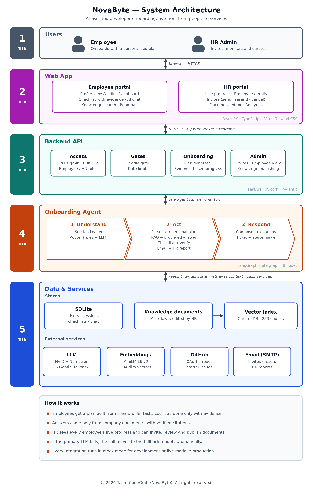
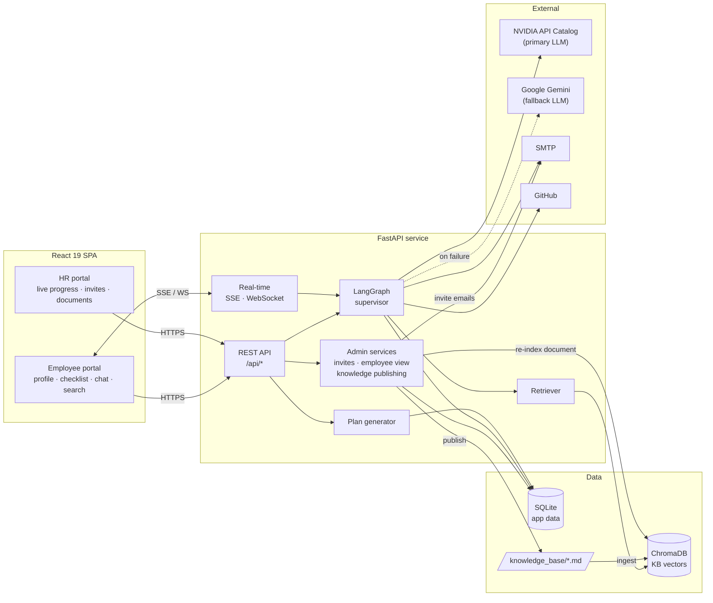
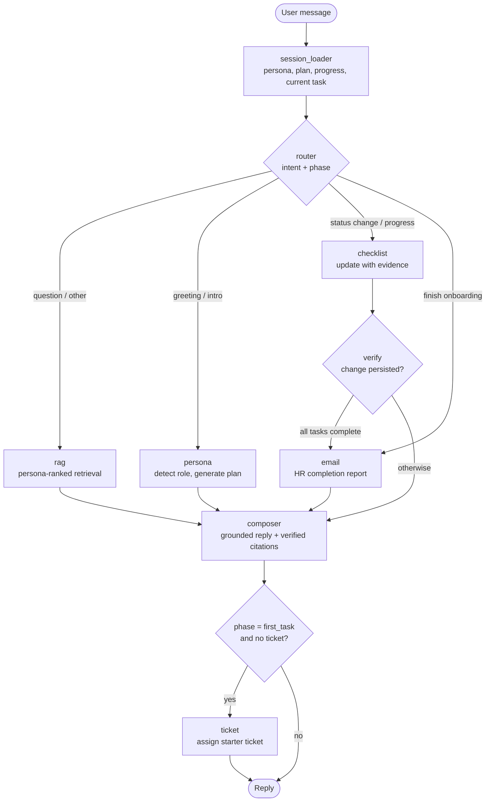
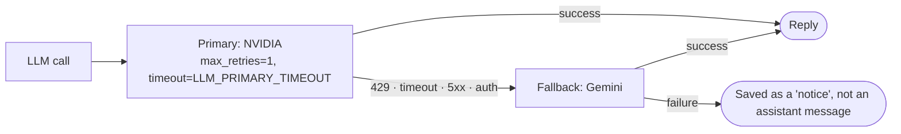
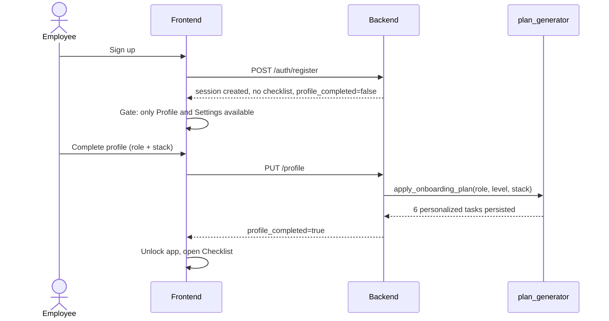
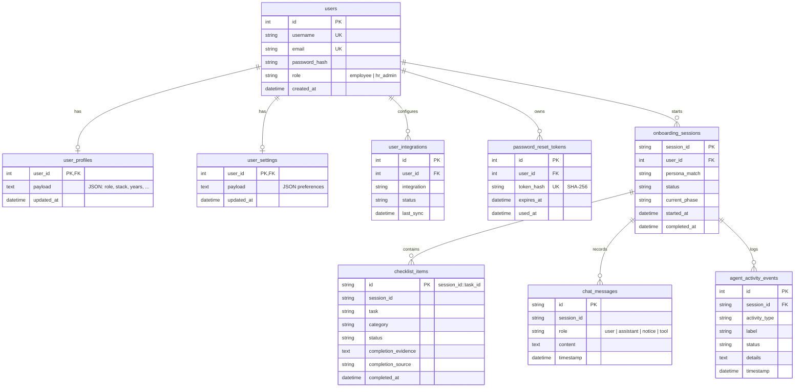

# Architecture

This document describes how NovaByte is built: the components, how a request moves through them, and why key design decisions were made. For setup and usage, see the [README](README.md) and [RUN_INSTRUCTIONS.md](RUN_INSTRUCTIONS.md).

**Contents**

1. [System overview](#1-system-overview)
2. [Backend](#2-backend)
3. [Agent workflow](#3-agent-workflow)
4. [LLM layer](#4-llm-layer)
5. [Retrieval (RAG)](#5-retrieval-rag)
6. [Onboarding plans and the profile gate](#6-onboarding-plans-and-the-profile-gate)
7. [Data model](#7-data-model)
8. [Real-time channels](#8-real-time-channels)
9. [Integrations and email](#9-integrations-and-email)
10. [Security](#10-security)
11. [Frontend](#11-frontend)
12. [Deployment and operations](#12-deployment-and-operations)
13. [Testing](#13-testing)
14. [Design decisions](#14-design-decisions)

---

## 1. System overview

NovaByte is a single-page React application backed by a FastAPI service. The backend hosts a LangGraph agent that combines retrieval over company documentation, a personalized onboarding checklist, and external integrations. Employees and HR admins use separate portals in the same app.

<p align="center">
  
</p>

*Architecture diagram © 2026 Team CodeCraft (NovaByte). All rights reserved. Generated by [`ieee_paper/figures/make_fig_architecture.py`](ieee_paper/figures/make_fig_architecture.py).*

The component-level view:



| Layer | Technology |
|---|---|
| Frontend | React 19, TypeScript, Vite, Tailwind CSS 4, React Router 7, react-markdown + remark-gfm |
| API | FastAPI, Pydantic, SlowAPI (rate limiting), Uvicorn |
| Agent | LangGraph `StateGraph`, LangChain |
| LLMs | NVIDIA API Catalog (`nvidia/nemotron-3.5-lightning-30b-a3b`), Google Gemini fallback |
| Retrieval | ChromaDB, `sentence-transformers/all-MiniLM-L6-v2` (384-dimensional) |
| Persistence | SQLite via SQLAlchemy 2 |
| Delivery | Docker Compose (Uvicorn backend, Nginx-served frontend), GitHub Actions CI |

---

## 2. Backend

```
backend/app/
├── main.py            app factory, middleware, startup sequence
├── config.py          environment-driven settings and validation
├── agent/             graph, nodes, tools, llm_loader, state
├── rag/               ingest, vectorstore, retriever
├── routes/            HTTP and WebSocket endpoints
├── services/          plan_generator, persona_matcher, profile_status, progress, email_generator, activity
├── integrations/      github, email (mock and real modes)
├── db/                models, crud, init_db (migrations), demo_seed
├── auth/              password hashing, JWT, WebSocket auth
└── log_redaction.py   strips tokens from server logs
```

### API surface

All routes are mounted under `/api`. Interactive documentation is served at `/docs`.

| Router | Endpoints | Purpose |
|---|---|---|
| `auth` | `POST /auth/register`, `/login`, `/google`, `/github`, `/logout`, `/forgot-password/request`, `/forgot-password/reset`; `GET /auth/me`; HR admin: `POST /auth/invite`, `GET /auth/invites`, `POST /auth/invites/{id}/resend`, `DELETE /auth/invites/{id}` | Accounts, JWT issue, OAuth sign-in, password reset, employee invites |
| `profile` | `GET /profile`, `GET /profile/options`, `PUT /profile` | Developer profile; saving a complete profile generates the plan |
| `sessions` | `POST/GET /sessions`, `GET /sessions/{id}`, `GET /sessions/{id}/chat`, `POST /sessions/{id}/chat`, `POST /sessions/{id}/chat/stream`, `WS /ws/chat/{id}`, `GET /sessions/{id}/checklist`, `PATCH /sessions/{id}/checklist/{item}`, `GET /sessions/{id}/progress`, `GET /sessions/{id}/activity`, `POST /sessions/{id}/complete` | Onboarding session, agent chat, checklist and progress |
| `knowledge` | `GET /knowledge/articles`, `GET /knowledge/articles/{id}`, `POST /knowledge/ask`; HR admin: `POST /knowledge/articles`, `PUT` / `DELETE /knowledge/articles/{id}` | Knowledge Base browsing, grounded Q&A, and document publishing with immediate re-indexing |
| `dashboard` | `GET /dashboard/timeline`, `/roadmap`, `/integrations`; `POST /dashboard/integrations/{id}/connect`, `/integrations/sync`; `WS /dashboard/ws/integrations`; HR admin: `GET /dashboard/analytics`, `GET /dashboard/employees/{session_id}` | Dashboards, integration status, and the per-employee detail view |
| `github` | `GET /github/oauth/redirect`, `POST /github/oauth/callback`, `GET /github/status`, `GET /github/data`, `POST /github/disconnect` | GitHub OAuth and repository data |
| `settings` / `system` | `GET/PUT /settings`, `GET /system/llm-status[?check=true]` | User preferences; LLM provider status and live health |

### Startup sequence

Startup is designed so the API accepts requests while slow work completes in the background (`app/main.py`):

1. Validate configuration. With `DEBUG=false`, startup aborts on an insecure `JWT_SECRET_KEY`.
2. Create or migrate the SQLite schema (`db/init_db.py`).
3. In debug mode, seed demo accounts (`demo_user`, `demo_hr`) and dashboard data.
4. In the background: index `knowledge_base/` into ChromaDB if the collection is empty, load the embedding model, and check the LLM provider.

If ingestion fails, the service still starts and the Knowledge Base falls back to keyword search.

---

## 3. Agent workflow

Every chat turn runs the supervisor graph in `agent/graph.py`. Graph state is rebuilt per turn from the database, so the agent is stateless between requests and any instance can serve any session.



| Node | File | Responsibility |
|---|---|---|
| `session_loader` | `nodes/session_loader.py` | Rehydrates persona (role, level, stack), plan, progress and the active task from SQLite |
| `router` | `nodes/router.py` | Rule-based intent classification with an LLM fallback for ambiguous input |
| `persona` | `nodes/persona.py` | Extracts role, seniority and stack from an introduction and persists a plan |
| `rag` | `nodes/rag.py` | Retrieves knowledge-base context, re-ranked for the user's persona |
| `checklist` | `nodes/checklist.py` | Applies status changes with evidence and source; computes progress and the next task |
| `verify` | `nodes/verify.py` | Confirms the checklist change was persisted before allowing finalization |
| `email` | `nodes/email.py` | Generates and sends the HR completion report |
| `composer` | `nodes/composer.py` | Calls the LLM under grounding rules and attaches only verified citations |
| `ticket` | `nodes/ticket.py` | Assigns a starter ticket via the GitHub integration |

### Routing rules

The router separates *asking* from *doing*:

- **Questions go to RAG**, including questions that mention a task ("Where is the repo URL for BI-02?") and questions asked before the user introduces themselves.
- **Checklist actions** are status reports ("I finished BI-01"), explicit change requests ("mark BI-02 as done", "set BI-03 to in progress"), and progress requests ("what's my progress?").
- **Completion** ("finish onboarding") routes to the email node.

### Grounding

The composer's system prompt restricts answers to the retrieved context and requires an explicit "the knowledge base does not provide enough information" response otherwise. After generation:

- Any model-written "Sources:" line is removed and replaced by the verified source list.
- Questions that name one of the user's tasks also receive that task's details as context.
- The app's own failure notices are never replayed to the model as assistant turns. A model shown its past error messages tends to repeat them.

---

## 4. LLM layer

`agent/llm_loader.py` builds a primary model and wraps it with a per-call fallback using LangChain's `with_fallbacks`.



| Setting | Default | Notes |
|---|---|---|
| `LLM_PROVIDER` | `nvidia` | `nvidia`, `gemini` (alias `google`), `openai`, `grok`, `anthropic` |
| `LLM_FALLBACK_PROVIDER` | `gemini` | Tried for any call the primary fails |
| `NVIDIA_MODEL` | `nvidia/nemotron-3.5-lightning-30b-a3b` | Must be a catalog model ID, not a display name |
| `NVIDIA_ENABLE_THINKING` | `false` | Sent as `chat_template_kwargs`; reasoning adds latency |
| `MOCK_LLM_ENABLED` | `false` | Deterministic offline model, used only when no provider is available (and by the tests) |

**Fail fast.** The primary gets one retry and a timeout so a quota error hands off quickly instead of retrying for minutes.

**Health.** `GET /api/system/llm-status` reports configuration. With `?check=true` it also sends each model a tiny request and reports `health` (`ok`, `failing` or `unavailable`) with a reason such as "Quota or rate limit exceeded". Results are cached for 60 seconds. Configuration alone cannot reveal an exhausted quota or a revoked key.

---

## 5. Retrieval (RAG)

### Ingestion

| Step | Implementation |
|---|---|
| Source | `backend/knowledge_base/**/*.md` (company overview, architecture, standards, setup guides, policies, org structure, FAQ) |
| Chunking | Split by Markdown headings (H1/H2/H3), then `RecursiveCharacterTextSplitter` (1000 characters, 200 overlap) within long sections |
| Metadata | Source file, section path, document type, and inferred `role`, `technology` and `experience_level` for persona ranking |
| Embeddings | `all-MiniLM-L6-v2`, loaded once per process and cached (`rag/vectorstore.py`) |
| Store | ChromaDB persistent collection `novabyte_knowledge_base` (L2 distance) |

Ingestion runs automatically at startup when the collection is empty, and in the test suite's session fixture.

### Retrieval (`rag/retriever.py`)

1. Fetch `max(6k, 25)` candidates by vector similarity.
2. Convert L2 distance to similarity, `similarity = 1 / (1 + distance)`, and drop chunks below the threshold (`RAG_SCORE_THRESHOLD`, raised to at least 0.405 for L2).
3. Re-rank with a soft persona boost. Generic company documents stay competitive because nothing is hard-filtered.

   | Signal | Adjustment |
   |---|---|
   | Chunk role matches the user's role | +0.15 |
   | Chunk role is specific and different | −0.05 |
   | Chunk technology overlaps the user's stack | +0.15 |
   | Chunk seniority matches | +0.05 |

4. Return the top `k` chunks as context plus structured citations (source, section, score).

Relevant questions typically score 0.45–0.63 similarity, while unrelated questions return no chunks.

### Knowledge Base "Ask AI"

`POST /knowledge/ask` retrieves with the asking user's persona, then asks the LLM for a grounded answer. Its response `mode` is explicit:

| `mode` | Meaning |
|---|---|
| `ai` | Generated answer with linkable citations |
| `excerpts` | No LLM available; the matching passages are returned verbatim |
| `none` | Nothing relevant, or the model declined; no citations attached |

---

## 6. Onboarding plans and the profile gate

### Flow



**Completeness rule** (`services/profile_status.py`): a role from the profile options plus at least one language or technology. Completion is derived from the stored profile rather than a separate flag, so existing users are classified correctly.

**Enforcement** happens on both sides:

- **Frontend:** `DashboardLayout` redirects to `/app/profile`, and the sidebar shows locked items.
- **Backend:** all chat endpoints (HTTP, SSE, WebSocket) return `403 PROFILE_INCOMPLETE`.
- HR admins are exempt.

### Plans

`services/plan_generator.py` is the single source of checklist tasks. Experience level comes from the profile: 0–2 years is junior, 3–4 mid, 5 or more senior.

| Role | Intern / Junior | Mid | Senior |
|---|---|---|---|
| Frontend | Junior Frontend (`JFR`) | Junior Frontend | Senior Frontend (`SFR`) |
| Backend, Node.js | Node.js Backend (`BI`) | Node.js Backend | Senior Backend (`SBE`), Squad Beta |
| Backend, Python | Python Backend (`JBP`) | Python Backend | Senior Backend (`SBE`), Squad Alpha |
| DevOps | Junior DevOps (`JDO`) | Senior DevOps (`SDO`) | Senior DevOps |
| ML / Data | ML / Data (`MLE`) | ML / Data | ML / Data |
| Fullstack | Fullstack (`FS`) | Fullstack | Fullstack |

Every plan has six tasks covering setup, repository access, running services locally, architecture review, standards, and a first ticket. Tasks reference real knowledge-base content: setup guides, repositories, team leads, policies, and the starter tickets in `agent_data/starter_tickets.md`.

**Re-planning** (for example after a profile change) upserts the new plan and removes only tasks that were never touched. Tasks that were started, completed, or have evidence are kept.

### Evidence-aware progress

A task counts as complete only with `completion_evidence`, `completion_source` and `completed_at`. This is enforced in `db/crud.py`, and status transitions are validated against an allowed-transition table.

```
progress % = verified completed tasks / total tasks × 100
```

---

## 7. Data model



`chat_messages.role = notice` stores the app's own failure messages. They are shown to the user but never sent to the model.

---

## 8. Real-time channels

| Channel | Endpoint | Used for |
|---|---|---|
| Server-sent events | `POST /api/sessions/{id}/chat/stream` | Chat replies, tool and activity events, `notice` events |
| WebSocket | `/api/ws/chat/{id}` | Same event stream for clients that prefer WebSockets |
| WebSocket | `/api/dashboard/ws/integrations` | Live integration status and sync events, with polling fallback |

**WebSocket authentication.** Browsers cannot set headers on a WebSocket, so the client offers the token as a subprotocol (`["novabyte.bearer", <jwt>]`, carried in the `Sec-WebSocket-Protocol` header). This keeps tokens out of URLs and therefore out of access and proxy logs. A legacy `?token=` query parameter is still accepted, and `log_redaction.py` masks such tokens in server logs.

---

## 9. Integrations and email

Each integration implements `IntegrationBase` (`verify`, `execute`) and has a `mock` or `real` mode, set by `*_MODE`. Mock mode never contacts external services.

| Integration | Real mode |
|---|---|
| GitHub | OAuth connect, repositories, issues and PRs; starter tickets for every role |
| Email | SMTP delivery of password resets and HR completion reports |

**Email** (`services/email_generator.py`) uses one shared sender:

- STARTTLS on port 587, implicit SSL on 465.
- `From` with a display name, plus `Date` and `Message-ID` headers.
- Actionable error messages, for example the Gmail App Password hint.
- **Integrations → Email → Connect** performs a real SMTP login.
- `scripts/send_test_email.py` validates the configuration end to end.

---

## 10. Security

| Concern | Mechanism |
|---|---|
| Passwords | PBKDF2-SHA256 (`passlib`) |
| Sessions | JWT, HS256, 7-day expiry; startup refuses the default secret when `DEBUG=false` |
| Password reset | Random token, stored only as a SHA-256 hash, 30-minute expiry, single use |
| Authorization | Roles `employee` and `hr_admin`; session access checks on every session route; admin-only dashboards |
| Rate limiting | SlowAPI: register 5/min, login 10/min, OAuth 15/min |
| Secrets | `backend/.env` is git-ignored and excluded from Docker images (`.dockerignore`); Compose injects it at runtime |
| Logs | Tokens in URLs are redacted from Uvicorn logs; API keys are never logged |
| LLM output | Grounding rules, verified-only citations, error notices excluded from model context |

---

## 11. Frontend

```
frontend/src/
├── pages/        one component per route
├── components/   layout (Sidebar, Navbar, DashboardLayout), Chat, auth modals
├── contexts/     AuthContext + useAuth (user, profile gate), ThemeContext + useTheme
├── hooks/        useChecklist, useIntegrationWebSocket, ...
├── services/     api.ts (Axios client, SSE/WebSocket streaming), errors.ts, googleAuth.ts
└── types/        shared TypeScript types
```

| Route | Access | Page |
|---|---|---|
| `/login`, `/signup`, `/forgot-password`, `/reset-password` | Public | Authentication |
| `/app/dashboard`, `/checklist`, `/roadmap`, `/timeline` | Employee, after profile | Onboarding views |
| `/app/profile` | Employee, always | Profile setup (gate target) |
| `/app/chat`, `/knowledge`, `/integrations` | Signed in, after profile for employees | Shared tools |
| `/app/settings` | Signed in, always | Preferences, theme, LLM health |
| `/app/admin`, `/app/analytics` | HR admin | Admin dashboard and analytics |

**Profile gate.** `useAuth().needsProfile` is true for employees with `profile_completed === false`. `DashboardLayout` then redirects every page except Profile and Settings.

**Layout.** On desktop the sidebar collapses to an icon rail, and the setting is remembered. Below the `lg` breakpoint it becomes a drawer opened from the navbar.

**Theming.** Colors are CSS custom properties with light and dark sets, toggled by a `.dark` class. Tailwind's `dark:` variant is bound to that class.

**Markdown.** Chat replies and articles render through `react-markdown` with GFM tables, styled by `.markdown-content`.

---

## 12. Deployment and operations

| Environment | How |
|---|---|
| Local | `python run.py` (Uvicorn with auto-reload) and `npm run dev` (Vite) |
| Containers | `docker compose up --build`: backend on `:8000`; frontend built by Vite and served by Nginx on `:5173` |
| CI | GitHub Actions on pushes and PRs to `main`: backend tests, frontend type-check and build |

Docker Compose stores SQLite and ChromaDB in named volumes (`SQLITE_DB_PATH=/app/data/onboarding.db`) and reads credentials from `backend/.env` at runtime.

**Operational scripts** (`backend/scripts/`):

- `cleanup_sessions.py`: repairs legacy sessions. It runs as a dry run by default and backs up the database before `--apply`.
- `send_test_email.py`: checks the SMTP setup.

---

## 13. Testing

`python -m pytest backend/tests` runs the backend suite. The tests:

- need no API keys: `conftest.py` forces the mock LLM and indexes the knowledge base on first run;
- use fakes for SMTP and LLM providers to exercise real-mode code paths without network access.

| Area | Representative tests |
|---|---|
| End-to-end agent | `test_e2e_canonical_personas.py`, `test_supervisor_workflow.py` |
| Routing and RAG | `test_rag_routing.py`, `test_rag_pipeline.py`, `test_rag_sources.py`, `test_golden_cases.py` |
| Knowledge Q&A | `test_knowledge_ask.py` |
| Plans, profile gate, progress | `test_single_checklist_plan.py`, `test_personalized_plan.py`, `test_evidence_aware_checklist.py` |
| LLM layer | `test_llm_fallback.py` |
| Platform | `test_platform_fixes.py` (WebSocket auth, log redaction, notices, health), `test_real_email.py`, `test_email.py`, `test_rbac_and_system.py` |

---

## 14. Design decisions

| Decision | Rationale |
|---|---|
| Agent state rebuilt from the database each turn | No server-side session memory; any instance can serve any request, and restarts lose nothing |
| Plan generated from the profile, behind a gate | The plan depends on role and stack; generating it earlier produced generic or duplicated checklists |
| Re-plans only remove untouched tasks | Profile changes never discard a user's progress |
| Evidence-aware completion | Progress reflects verified work, not just a status flag |
| Soft persona re-ranking instead of filtering | Role-specific docs rank higher, but company-wide policies remain reachable for everyone |
| Per-call LLM fallback with fail-fast primary | Quota and rate-limit errors are common on free tiers; users get an answer from the fallback within seconds |
| Live health probes in addition to configuration | A configured provider can still be out of quota; Settings shows real status |
| Failures stored as `notice`, never as assistant turns | Prevents the model from learning to repeat error text |
| Mock-first integrations | The whole product runs locally without third-party credentials |
| SQLite and ChromaDB | Zero-ops persistence for a single instance. Scaling horizontally means moving to a server database and a hosted vector store |
