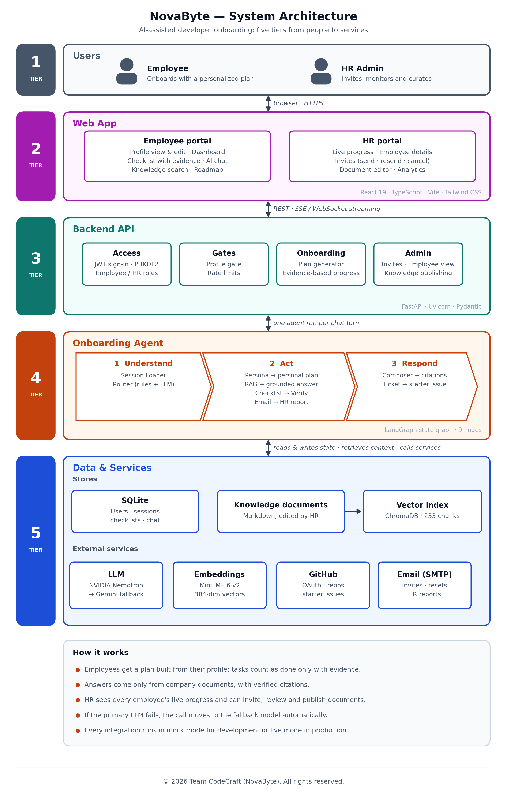
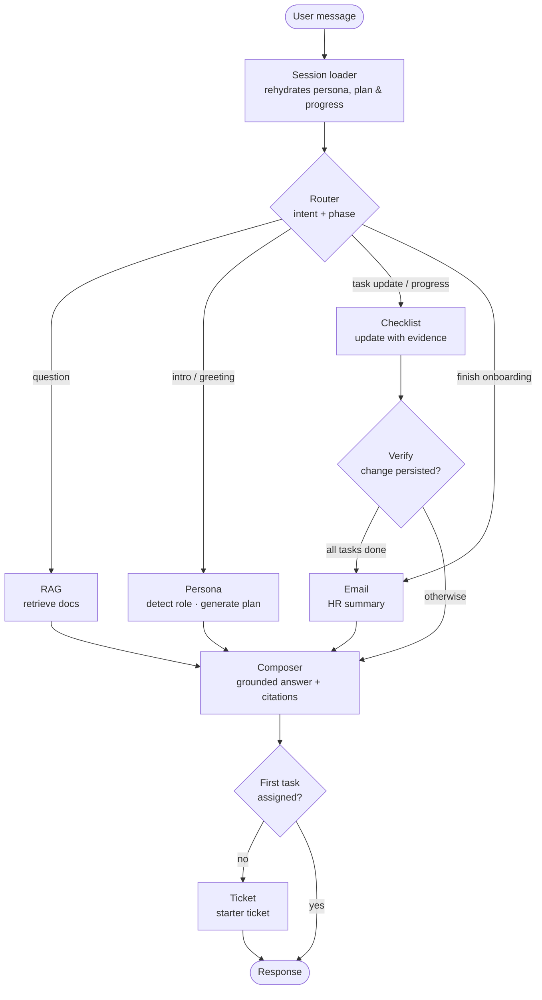

<div align="center">

# NovaByte: Autonomous Developer Onboarding Agent

**An AI onboarding assistant that gives every new engineer a personalized plan, answers questions from company documentation, and tracks progress through to HR sign-off.**

[](https://github.com/CMPN-CODECELL/Syrus2026_CodeCraft/actions/workflows/ci.yml)


[Features](#features) · [Architecture](#architecture) · [Quick start](#quick-start) · [Configuration](#configuration) · [Testing](#testing) · [Project structure](#project-structure)

</div>

---

## Overview

Developer onboarding usually depends on whoever is free to help, so every new joiner gets a different experience. NovaByte replaces that with one consistent, self-serve flow:

1. **Introduce yourself** in chat (*"I'm a backend intern working with Node.js"*). The agent identifies your persona and generates a role-specific onboarding plan.
2. **Ask anything** about the company. Answers are grounded in the internal knowledge base with citations, and the agent says so plainly when the docs don't cover a question.
3. **Work through your checklist.** Progress is evidence-based: a task counts as complete only when it is recorded with evidence and a source.
4. **Finish onboarding.** Completion triggers an HR summary email, and HR admins follow every session from their own dashboard.

## Features

| Area | What it does |
|---|---|
| **Agentic chat** | LangGraph supervisor with intent routing, streaming responses (SSE) and a live agent-activity panel |
| **Personalized plans** | Persona detection from free text or profile; role-, seniority- and stack-specific plans that replace the generic starter plan without losing progress |
| **Grounded RAG** | ChromaDB semantic search with persona-aware re-ranking, a similarity threshold, verified citations and refusal when context is insufficient |
| **Knowledge Base** | Browsable company docs plus *Ask AI*: generated answers with clickable source links, or labelled excerpts when no model is available |
| **Progress tracking** | Checklist, roadmap, timeline and dashboard views; status transitions validated server-side |
| **HR suite** | Admin dashboard across all sessions, analytics and completion-email workflow (mock or SMTP) |
| **Integrations** | GitHub (OAuth) and Email, mock-first and switchable to live per integration |
| **Resilient LLM layer** | NVIDIA-hosted Nemotron as primary with automatic per-call fallback to Google Gemini |
| **Auth & security** | JWT auth, Google/GitHub sign-in, password reset, role-based access (employee / HR admin), rate limiting |
| **Responsive UI** | Light/dark themes, mobile navigation drawer, accessible controls |

## Architecture

<p align="center">
  
</p>

Five tiers, from the people using NovaByte down to the services it relies on. The diagram is generated by [`ieee_paper/figures/make_fig_architecture.py`](ieee_paper/figures/make_fig_architecture.py).

*Architecture diagram © 2026 Team CodeCraft (NovaByte). All rights reserved.*

### Agent workflow

Every chat turn runs through the supervisor graph (`backend/app/agent/graph.py`):



The full design (agent workflow, LLM layer, RAG pipeline, plans, data model, security) is documented in [ARCHITECTURE.md](ARCHITECTURE.md).
The algorithms behind retrieval, routing, persona matching and security are listed in [ALGORITHMS_USED.md](ALGORITHMS_USED.md).

## Tech stack

| Layer | Technologies |
|---|---|
| **Frontend** | React 19, TypeScript 5.9, Vite, Tailwind CSS 4, React Router 7, react-markdown |
| **Backend** | FastAPI, SQLAlchemy 2, Pydantic, SlowAPI, Uvicorn |
| **AI** | LangGraph, LangChain, NVIDIA API Catalog (`nvidia/nemotron-3.5-lightning-30b-a3b`), Google Gemini |
| **Retrieval** | ChromaDB, `sentence-transformers/all-MiniLM-L6-v2` embeddings |
| **Data** | SQLite (application data), ChromaDB (vectors) |
| **Tooling** | pytest, ESLint, GitHub Actions, Docker Compose |

## Quick start

### Prerequisites

- Python **3.11+**
- Node.js **20+** and npm
- An [NVIDIA API key](https://build.nvidia.com) and/or a [Google Gemini API key](https://aistudio.google.com/apikey)

### 1. Configure

```bash
git clone https://github.com/CMPN-CODECELL/Syrus2026_CodeCraft.git
cd Syrus2026_CodeCraft

cp backend/.env.example backend/.env          # Windows: Copy-Item backend\.env.example backend\.env
cp frontend/.env.example frontend/.env        # Windows: Copy-Item frontend\.env.example frontend\.env
```

Add at least one LLM key to `backend/.env`:

```ini
NVIDIA_API_KEY=nvapi-...        # primary
GOOGLE_API_KEY=...              # fallback
```

### 2. Run the backend (terminal 1)

```bash
cd backend
pip install -r requirements.txt
python run.py                   # http://localhost:8000
```

The first start takes about 15–30 seconds while it indexes the knowledge base and loads the embedding model.

### 3. Run the frontend (terminal 2)

```bash
cd frontend
npm install
npm run dev                     # http://localhost:5173
```

### 4. Sign in

Open **http://localhost:5173**. In debug mode (the default) two demo accounts are seeded:

| Role | Username | Password |
|---|---|---|
| Employee | `demo_user` | `DemoPass123!` |
| HR admin | `demo_hr` | `DemoPass123!` |

You can also create your own account from the sign-up page.

> **Docker:** `docker compose up --build` runs both services (backend on `:8000`, frontend on `:5173`) using the keys in `backend/.env`.

For a step-by-step walkthrough and troubleshooting, see [RUN_INSTRUCTIONS.md](RUN_INSTRUCTIONS.md).

## Configuration

All backend settings live in `backend/.env` (template: [`backend/.env.example`](backend/.env.example)).

| Variable | Default | Purpose |
|---|---|---|
| `LLM_PROVIDER` | `nvidia` | Primary model provider: `nvidia`, `gemini`, `openai`, `grok`, `anthropic` |
| `LLM_FALLBACK_PROVIDER` | `gemini` | Retries any call the primary fails (quota, rate limit, timeout) |
| `NVIDIA_API_KEY` / `NVIDIA_MODEL` | — / `nvidia/nemotron-3.5-lightning-30b-a3b` | NVIDIA API Catalog key and model ID (see [choosing a model](RUN_INSTRUCTIONS.md#choosing-an-nvidia-model)) |
| `GOOGLE_API_KEY` / `GEMINI_MODEL` | — / `gemini-3.5-flash` | Google Gemini credentials and model |
| `LLM_PRIMARY_TIMEOUT` | `60` | Seconds before a slow primary call hands off to the fallback |
| `MOCK_LLM_ENABLED` | `false` | Allow a deterministic offline model when no provider is configured |
| `RAG_SCORE_THRESHOLD` | `0.3` | Minimum similarity for a retrieved chunk to be used |
| `EMAIL_MODE`, `GITHUB_MODE` | `mock` | `mock` for local development, `real` to call live services |
| `SMTP_HOST`, `SMTP_PORT`, `SMTP_USER`, `SMTP_PASSWORD`, `HR_EMAIL` | Gmail defaults | SMTP delivery when `EMAIL_MODE=real` (see [sending real email](RUN_INSTRUCTIONS.md#sending-real-email)) |
| `JWT_SECRET_KEY` | dev default | **Must** be changed for any non-local deployment |
| `DEBUG` | `true` | Enables demo-data seeding and development defaults |

Active provider and fallback status are visible in the app under **Settings → AI Engine & LLM**, or at `GET /api/system/llm-status`.

## Testing

```bash
python -m pytest backend/tests -q     # 107 backend tests
cd frontend && npm run lint && npm run build
```

Or run both with `make verify`. The suite covers the agent workflow end to end (three canonical personas), routing between RAG and checklist actions, evidence-aware progress, persona-aware retrieval, the Knowledge Base Q&A endpoint, LLM fallback, integrations, email generation and role-based access. Tests use a deterministic mock model, so they need no API keys, and they index the knowledge base automatically on first run.

CI ([`.github/workflows/ci.yml`](.github/workflows/ci.yml)) runs the backend tests and the frontend type-check and build on every push and pull request to `main`.

## Project structure

```
.
├── backend/
│   ├── app/
│   │   ├── agent/          # LangGraph graph, nodes (router, persona, rag, checklist, ...), tools, LLM loader
│   │   ├── rag/            # Knowledge-base ingestion, vector store, persona-aware retriever
│   │   ├── routes/         # FastAPI routers: auth, sessions, knowledge, dashboard, profile, github, settings
│   │   ├── services/       # Plan generation, persona matching, progress, email, activity
│   │   ├── integrations/   # GitHub, Email (mock + live)
│   │   └── db/             # SQLAlchemy models, CRUD, migrations, demo seed
│   ├── agent_data/         # Employee personas, checklists, starter tickets
│   ├── knowledge_base/     # Company documentation indexed for RAG
│   ├── tests/              # pytest suite
│   └── run.py              # Development server entry point
├── frontend/
│   └── src/
│       ├── pages/          # Dashboard, Chat, Checklist, Knowledge Base, HR Admin, Analytics, ...
│       ├── components/     # Layout (sidebar, navbar), chat, auth modals
│       ├── services/       # API client
│       └── contexts/       # Auth and theme state
├── docker-compose.yml
├── Makefile
├── ARCHITECTURE.md
├── ALGORITHMS_USED.md
└── RUN_INSTRUCTIONS.md
```

## API overview

Interactive API documentation is served at **http://localhost:8000/docs** while the backend is running.

| Endpoint | Description |
|---|---|
| `POST /api/auth/register`, `POST /api/auth/login` | Account creation and JWT login |
| `POST /api/sessions/{id}/chat/stream` | Agent chat with server-sent events |
| `GET /api/sessions/{id}/checklist`, `GET /api/sessions/{id}/progress` | Onboarding plan and progress |
| `POST /api/knowledge/ask` | Grounded Q&A over the knowledge base (`mode`: `ai`, `excerpts` or `none`) |
| `GET /api/dashboard/analytics`, `GET /api/dashboard/integrations` | Dashboards and integration status |
| `GET /api/system/llm-status` | Active LLM provider and fallback health |

## Security notes

- Keep secrets in `backend/.env`; it is git-ignored and excluded from Docker images.
- Set a strong `JWT_SECRET_KEY` and `DEBUG=false` before deploying; with debug off the server refuses to start on the default secret.
- Integrations default to `mock` and never call external services until set to `real` with credentials.
